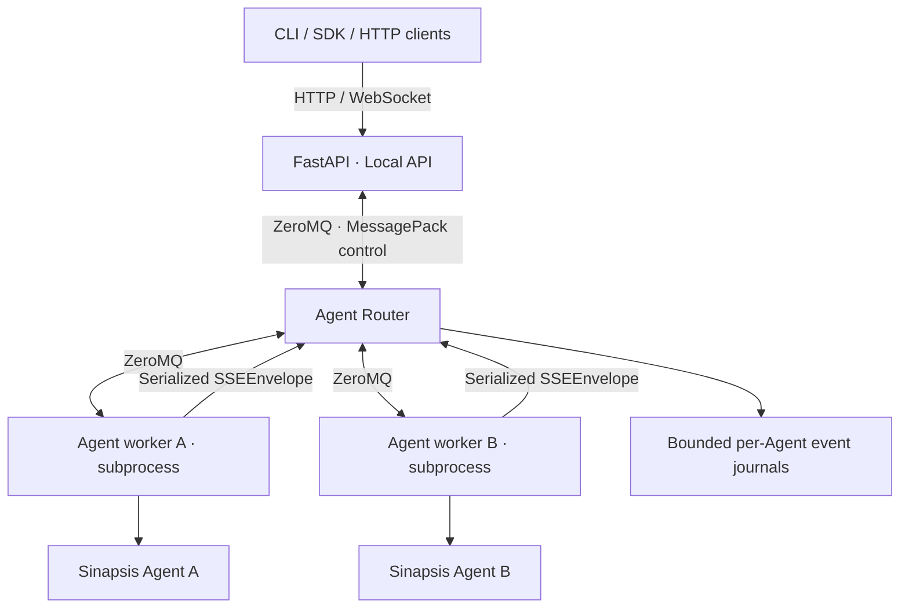

<h1 align="center">
<br>
<a href="https://sinapsis.tech/">
  
</a>
<br>
sinapsis-api
<br>
</h1>

<h3 align="center">Local HTTP and WebSocket execution for Sinapsis Agents.</h3>

`sinapsis-api` provides a **local execution service** for Sinapsis Agents. It exposes HTTP endpoints for Agent and job management, and WebSocket/binary event delivery for observing execution. Agents run in separate subprocesses rather than inside FastAPI request handlers.

This package is the **Local API**, not the Sinapsis Cloud service. For applications that consume its endpoints, the recommended Python interface is [`sinapsis-sdk`](../../sdk/sinapsis-sdk/README.md).

## Architecture



**Responsibilities are deliberately separated:**

| Component | Responsibility |
| --- | --- |
| **FastAPI** | Validates requests, forwards Router commands, exposes HTTP and WebSocket responses. |
| **Agent Router** | Owns worker lifecycle, job state, event journals, subscription management and replay. |
| **Agent worker** | Instantiates and runs a Sinapsis Agent in its own OS process; emits execution events. |
| **Sinapsis runtime** | Evaluates the Agent graph and its Templates using the shared `DataContainer` contract. |

Multiple API workers can connect to the same Router, sharing Agent processes and event history.

## Installation

Requires **Python 3.13+**.

```bash
uv pip install sinapsis-api
# or
pip install sinapsis-api
```

For normal local execution, use the `sinx-api` profile of [`sinapsis-cli`](../../cli/sinapsis-cli/README.md). The instructions below show how to run the service components directly for development or self-managed operation.

## Run the Local API

The **Router must be started before FastAPI**. In two terminals within an environment containing `sinapsis-api`:

**Terminal 1 — Router**

```bash
python -m sinapsis_api.agent_router
```

**Terminal 2 — HTTP API**

```bash
uvicorn sinapsis_api.api.main:app --host 127.0.0.1 --port 8005
```

Check connectivity:

```bash
curl http://127.0.0.1:8005/api/v1/health
```

The health response includes the Router's stream identifier. The interactive OpenAPI documentation is available at `http://127.0.0.1:8005/docs` when the service is running.

> The Router and API are separate processes. Avoid running two Routers against the same configured endpoints.

## HTTP API

Routes are versioned under `/api/v1` and share typed request/response models from [`sinapsis-contracts`](../../sdk/sinapsis-contracts/README.md).

| Method | Path | Purpose |
| --- | --- | --- |
| `GET` | `/api/v1/health` | Check API-to-Router connectivity and obtain `stream_id`. |
| `POST` | `/api/v1/agents` | Start an Agent process from a validated `AgentSchema` JSON representation. |
| `DELETE` | `/api/v1/agents/{agent_id}` | Stop an Agent process. |
| `GET` | `/api/v1/agents/{agent_id}/events` | Replay retained Agent events with optional cursor and job filtering. |
| `WS` | `/api/v1/agents/{agent_id}/events/ws` | Receive live events or replay-then-live delivery. |
| `POST` | `/api/v1/jobs` | Start a finite job for a previously created Agent. |
| `GET` | `/api/v1/jobs/{job_id}` | Retrieve job status. |
| `POST` | `/api/v1/jobs/{job_id}/cancel` | Cancel a running job. |
| `POST` | `/api/v1/jobs/{job_id}/feedback` | Submit approval feedback for an execution. |

A finite execution has two separate identities: `agent_id` identifies the Agent instance and its event stream, while `job_id` identifies one execution. Do not interchange them.

### Create an Agent

`POST /api/v1/agents` accepts a JSON representation of the framework's **validated `AgentSchema`**. The service can assign an Agent ID if it is missing.

To prepare a schema from a user-defined Agent configuration:

```python
from sinapsis.agent import AgentSchema, generic_agent_schema_builder

schema: AgentSchema = generic_agent_schema_builder(agent_definition)
agent_json = schema.model_dump_json()
```

The API receives `agent_json` as the request body. This is not the same as a Cloud `jobs.submit()` request, which wraps the user-defined graph under `agent_definition`.

### Start and inspect a job

Once an Agent has been started and its `agent_id` returned:

```bash
curl -X POST http://127.0.0.1:8005/api/v1/jobs \
  -H 'Content-Type: application/json' \
  -d '{"agent_id":"AGENT_ID"}'
```

The response contains a `job_id`. To inspect it:

```bash
curl http://127.0.0.1:8005/api/v1/jobs/JOB_ID
```

You can also submit and inspect jobs using `SinapsisAPIClient.jobs` from the SDK, which handles Agent creation and job submission together.

`StartJobRequest.payload` is optional; when supplied, it must be a base64-encoded serialized `DataContainer`.

### Agent and job lifecycles

An Agent is a running execution context; a job is one finite execution against it. Job state is tracked separately from application events.

```text
Agent definition -> Agent process started -> Agent ready
                                                |
                                                v
                                    Job queued -> running
                                                |       |       |
                                           completed  failed  cancelled
```

The runtime supports finite `SINGLE` and `GENERATOR` execution modes. Long-running `LOOP_FOREVER` Agents are started as production tasks rather than submitted as finite jobs.

## Event transport and replay

Application output and Router control traffic are separate:

1. A worker packages execution data into a Sinapsis `SSEEnvelope` and serializes it to MessagePack bytes.
2. ZeroMQ carries the serialized event to the Router.
3. The Router retains it in a bounded per-Agent journal and distributes the **same opaque payload** to subscribers; it does not deserialize the `DataContainer` for routing.
4. FastAPI delivers event frames to clients over WebSocket or through an HTTP replay response.

This avoids repeated decoding of potentially large image, audio, array, and binary payloads along the transport path.

### Event cursors

Events receive monotonically increasing `cursor` values within a logical Agent stream. Expiring older events does not renumber later cursors. Every stream has a `stream_id`.

- `WS /api/v1/agents/{agent_id}/events/ws` without `after` subscribes to new events only.
- `WS /api/v1/agents/{agent_id}/events/ws?after=0` replays the currently retained window, then receives live events.
- `WS /api/v1/agents/{agent_id}/events/ws?after=123` resumes after cursor `123`, subject to retention limits.
- `GET /api/v1/agents/{agent_id}/events?after=123` returns a bounded replay page. Optional `job_id` filters by execution.

Replay responses use `application/x-sinapsis-events` and length-prefixed binary frames. Replay headers include the stream ID, oldest/latest/next cursor, truncation status, and whether additional pages remain.

The client should persist its last processed cursor. If an old cursor has fallen outside the retained window, the Router replays what is still available and reports truncation.

### Binary frame layout

```text
MessagePack metadata header | serialized SSEEnvelope bytes
```

Metadata identifies the stream, cursor, Agent, worker instance and (when applicable) job. SDK consumers can use `LocalJobEvent.metadata` and `LocalJobEvent.envelope`; raw WebSocket clients must decode the framing and envelope correctly.

## Bounded retention and backpressure

The local Router keeps a **rolling event journal**, not an indefinite archive. Limits apply to event age, event count, cumulative event bytes, and replay-page size.

| Configuration | Default | Meaning |
| --- | --- | --- |
| `SINAPSIS_API_EVENT_RETENTION_SECONDS` | `3600` | Maximum retained age of journal events. |
| `SINAPSIS_API_EVENT_MAX_EVENTS_PER_AGENT` | `10000` | Maximum event count per Agent. |
| `SINAPSIS_API_EVENT_MAX_BYTES_PER_AGENT` | `268435456` | Maximum retained event bytes per Agent. |
| `SINAPSIS_API_EVENT_MAX_BYTES` | `104857600` | Maximum accepted size of one serialized event. |
| `SINAPSIS_API_EVENT_REPLAY_LIMIT` | `1000` | Maximum event count per replay page. |
| `SINAPSIS_API_SUBSCRIBER_QUEUE_SIZE` | `1024` | Pending live events per subscriber. |
| `SINAPSIS_API_STOPPED_AGENT_RETENTION_SECONDS` | `86400` | Retention of stopped-Agent journals before cleanup. |

For example, to retain recent events longer:

```bash
export SINAPSIS_API_EVENT_RETENTION_SECONDS=7200
```

Additional configuration controls worker outbound queue capacity, ZeroMQ high-water marks, startup timeouts and journal cleanup intervals. These bounded queues prevent a slow subscriber from indefinitely blocking other consumers. When a subscriber falls behind, it can reconnect from its last received cursor while the missing events remain retained.

## Runtime configuration

The Router's default ZeroMQ endpoints are:

| Environment variable | Default |
| --- | --- |
| `SINAPSIS_API_ROUTER_API_ENDPOINT` | `tcp://127.0.0.1:8765` |
| `SINAPSIS_API_ROUTER_AGENT_ENDPOINT` | `tcp://127.0.0.1:8766` |
| `SINAPSIS_API_ROUTER_STREAM_ENDPOINT` | `tcp://127.0.0.1:8767` |

The local direct-start examples use loopback endpoints. When running Router and API in separate containers, configure network-reachable endpoints instead; each container's `127.0.0.1` is its own network namespace.

The local API requires no external Redis or RabbitMQ broker for its Router-to-worker event transport. ZeroMQ provides IPC; the Router owns short-term event retention.

## Integration with the SDK and CLI

For most applications, use the SDK instead of implementing binary event framing manually:

```python
import asyncio

from sinapsis.agent import AgentSchema, generic_agent_schema_builder
from sinapsis_sdk.common.base_config import BaseAPIConfig
from sinapsis_sdk.local_api.client import SinapsisAPIClient


async def run(agent_definition: dict) -> None:
    schema: AgentSchema = generic_agent_schema_builder(agent_definition)

    async with SinapsisAPIClient(
        BaseAPIConfig(api_url="http://127.0.0.1:8005")
    ) as client:
        submitted = await client.jobs.submit(schema)
        print("Submitted:", submitted.job_id)
        status = await client.jobs.get_status(submitted.job_id)
        print("Status:", status.status)


# asyncio.run(run(your_agent_definition))
```

The `sinx-api` CLI profile provides a command-line interface to the same local execution backend. See the [Sinapsis CLI README](../../cli/sinapsis-cli/README.md) for CLI-specific commands.

## Documentation and resources

- [Sinapsis documentation](https://docs.sinapsis.tech/)
- [Tutorials and examples](https://docs.sinapsis.tech/docs/latest/tutorials)
- [Sinapsis website](https://sinapsis.tech/)

## License

Sinapsis open-source components are available under your choice of the  [MIT License](LICENSE-MIT); or the [Apache License 2.0](LICENSE-APACHE) unless otherwise noted. 
