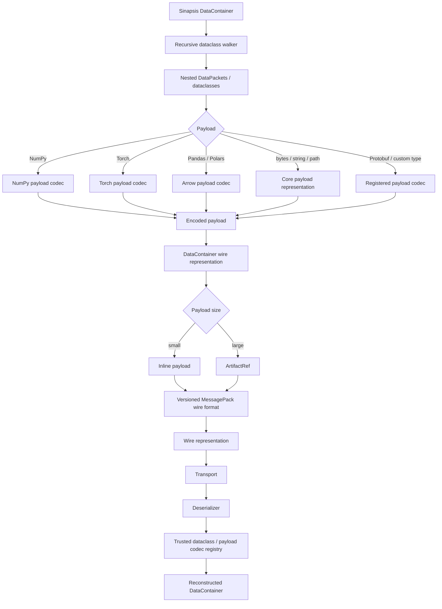

<h1 align="center">
<br>
<a href="https://sinapsis.tech/">
  
</a>
<br>
Sinapsis Protocol
<br>
</h1>

<h3 align="center">Versioned Universal Data Transport for Sinapsis.</h3>

`sinapsis-protocol` implements **Universal Data Transport (UDT)**: a Python protocol for serializing, transporting, and reconstructing Sinapsis `DataContainer` objects and their nested packets.

The protocol standardizes the **container and wire representation** while allowing individual payloads to use the format best suited to their data. MessagePack is the common wire format; NumPy, Torch, Apache Arrow, Protobuf, or an application-defined representation can be used **within a payload**, without replacing the `DataContainer` boundary.

> **Core principle: Standardize the container. Optimize the payload.**

`DataContainer` and packet types belong to `sinapsis-core` and are exposed through the stable `sinapsis.data_transport` interface. `sinapsis-protocol` is responsible for their transport representation. It is **not** a general-purpose Python object serializer and does not implicitly serialize arbitrary Python classes.

## Why this exists

Sinapsis data may cross Agent, process, worker, or service boundaries. Its transport contract needs to be:

- **Recursive:** containers hold packet dataclasses, which can themselves hold structured values.
- **Versioned:** the wire protocol and registered data types have explicit versions.
- **Binary-friendly:** arrays and other binary payloads are transmitted without converting them into JSON lists.
- **Extensible:** applications can register dataclass types and leaf/payload adapters.
- **Artifact-aware:** large payloads may be stored separately and referenced by `ArtifactRef`.
- **Bounded:** decoding and encoding impose configurable limits on structure and payload sizes.
- **Safe by design:** no automatic pickle or cloudpickle fallback, and no dynamic import of arbitrary wire types.
- **Dependency-light:** specialised adapters are optional and loaded when needed.
- **Format-agnostic at the boundary:** payload representation can change without changing the `DataContainer` contract.

## Why binary transport matters

AI and ML workloads frequently exchange **arrays, tensors, images, audio, and tabular data**, rather than just small text objects. The cost of converting those payloads into a generic interchange format can become significant when Templates exchange data repeatedly or stream results at high frequency.

Consider a NumPy `float32` array with shape `(1024, 1024)`. Its numerical content occupies **4 MiB** as raw values. Turning it into a JSON array would require expanding a million values into decimal text, allocating a much larger intermediate representation in many cases, parsing those strings on receipt, and reconstructing the original dtype and shape. JSON is useful for human-readable configuration and API metadata, but it is not an efficient default for large numerical payloads.

`sinapsis-protocol` instead separates **structure** from **content**:

- **MessagePack** carries the versioned container structure, packet fields, and typed payload descriptors.
- **NumPy** arrays are encoded as contiguous binary bytes plus dtype, shape, and layout metadata.
- **Torch** tensors use a binary representation and the metadata required for reconstruction.
- **Pandas / Polars** tables use **Apache Arrow IPC**, preserving a columnar binary interchange format rather than converting each row into JSON objects.
- **Bytes, strings, paths, and custom types** follow their respective core representations or explicitly registered codecs.

The receiver uses the descriptor to choose the correct decoder and reconstruct the supported Python value. The outer `DataContainer` remains the same regardless of the payload codec.

```text
JSON-oriented numerical transport             Sinapsis UDT
------------------------------------          ---------------------------------
array → Python numbers → JSON text             array → binary bytes + dtype/shape
      → parse numbers → rebuild array                → MessagePack metadata
                                                    → rebuild typed array
```

**Why it helps:** less numeric-to-text conversion, fewer large temporary objects, and less time spent encoding and parsing payloads. That matters for real-time video, high-throughput inference, time-series streams, and distributed model training. Payload size, CPU cost, copying, and network latency all affect the result; this is a design choice, **not a promise of zero-copy operation or a fixed speedup**. For example, adapters may make an array contiguous or move a tensor to CPU memory before encoding.

### Keep the data contract stable, not every payload format identical

A Torch tensor does not need to become a list simply because a downstream Template uses NumPy, and a DataFrame does not need to be converted to a list of dictionaries for transport. Each codec preserves the **useful native binary representation and type metadata** as far as its implementation allows. Compatibility is enforced at the container and codec boundaries, rather than by forcing every library into the least expressive format.

## Architecture



**Protobuf and other specialised formats are payload codecs.** They encode individual payloads inside packets; they do not bypass the generic UDT container or its MessagePack envelope.

The generic path is:

```text
DataContainer
    ↓
recursive dataclass walker
    ↓
nested packet dataclasses
    ↓
leaf-value dispatch
    ↓
typed payload representation / inline bytes / ArtifactRef
    ↓
versioned MessagePack envelope
    ↓
transport
    ↓
registered decoding and reconstruction
```

A specialised application may deliberately choose a separate, fixed contract:

```text
Application-specific contract
    ↓
Protobuf schema
    ↓
Protobuf bytes
```

That is appropriate when both endpoints explicitly agree on a fixed schema and do not require the general `DataContainer` protocol. It is a different choice from embedding a Protobuf payload *inside* UDT.

## Installation

Requires **Python 3.13+**. Install directly from the standard Python package index:

```bash
uv pip install sinapsis-protocol
# or
pip install sinapsis-protocol
```

Optional payload adapters:

```bash
uv pip install 'sinapsis-protocol[numpy]'
uv pip install 'sinapsis-protocol[torch]'
uv pip install 'sinapsis-protocol[pandas]'
uv pip install 'sinapsis-protocol[polars]'
uv pip install 'sinapsis-protocol[cv2]'

# All bundled optional adapters
uv pip install 'sinapsis-protocol[all]'
```

`msgpack` is a required dependency. Optional libraries are not required when transferring ordinary container metadata, text, or bytes.

## Basic usage

The main entry points serialize and deserialize a Sinapsis container:

```python
from sinapsis.data_transport import DataContainer, TextPacket
from sinapsis_protocol import deserialize_data_container, serialize_data_container

container = DataContainer(texts=[TextPacket(content="Hello from Sinapsis")])

packet: bytes = serialize_data_container(container)
restored = deserialize_data_container(packet)

assert isinstance(restored, DataContainer)
assert restored.texts[0].content == "Hello from Sinapsis"
```

`serialize` and `deserialize` are equivalent general entry points for supported values. The `*_data_container` names make the intended UDT boundary explicit.

### Multimodal content and recursive traversal

With the NumPy adapter installed:

```python
import numpy as np
from sinapsis.data_transport import DataContainer, ImagePacket, TextPacket
from sinapsis_protocol import deserialize_data_container, serialize_data_container

container = DataContainer(
    images=[
        ImagePacket(content=np.arange(300, dtype=np.float32).reshape(3, 10, 10))
    ],
    texts=[TextPacket(content="example")],
)

packet = serialize_data_container(container)
restored = deserialize_data_container(packet)

assert isinstance(restored.images[0].content, np.ndarray)
assert restored.images[0].content.shape == (3, 10, 10)
```

The serializer traverses the logical tree recursively:

```text
DataContainer
├── images
│   └── ImagePacket
│       ├── content ── NumPy adapter → binary payload
│       ├── id
│       ├── source
│       └── other packet fields
└── texts
    └── TextPacket
        └── content ── string
```

The registered adapter applies to the *leaf value*. All other dataclass fields are encoded as part of the same recursive structure, including packet identifiers, metadata, and provenance fields when present.

### Empty-container sentinel

An empty `DataContainer` is an intentional fast path:

```python
from sinapsis.data_transport import DataContainer
from sinapsis_protocol import (
    ProtocolSentinel,
    deserialize_data_container,
    serialize_data_container,
)

packet = serialize_data_container(DataContainer())
assert deserialize_data_container(packet) is ProtocolSentinel.EMPTY_CONTAINER
```

This is a **protocol control value**, not an ordinary reconstructed `DataContainer`. Callers should handle it explicitly when decoding streams.

## Wire format

A normal encoded container is a versioned MessagePack envelope. Its conceptual structure is:

```python
{
    "protocol": "sinapsis-data",
    "major": 1,
    "minor": 0,
    "kind": "container",
    "payload": ...,
}
```

The fields separate protocol identity, compatibility version, message kind, and the encoded data tree. The top-level structure is consistent even when its leaf values use different codecs.

### Structured dataclass representation

A registered dataclass is represented conceptually as:

```python
{
    "__type__": "dataclass",
    "version": 1,
    "name": "myapp:my-custom-packet",
    "fields": {
        "field_a": ...,
        "field_b": ...,
    },
}
```

The `name` and `version` select a type from the receiver's **explicit dataclass registry**. The Python module path need not be part of the wire contract.

### Typed payload and transport models

Internally, the protocol uses typed dataclasses to describe payloads and their representations. A simplified view of the actual model structure is:

```text
TransportValue
├── descriptor: PayloadDescriptor
│   ├── kind
│   ├── version
│   ├── library
│   └── codec
├── metadata: Metadata
│   └── type-specific fields (shape, dtype, device, ...)
└── payload: Payload
    ├── kind: INLINE | ARTIFACT
    ├── inline: InlinePayload | None
    ├── artifact: ArtifactPayload | None
    └── extras
```

`ArrayMetadata`, `TorchMetadata`, `ImageMetadata`, `DataFrameMetadata`, and other specialised metadata classes capture representation-specific details. The typed models are converted to ordinary MessagePack-compatible mappings at the final wire boundary.

An encoded NumPy value looks conceptually like:

```python
{
    "__type__": "array",
    "version": 1,
    "library": "numpy",
    "codec": "raw",
    "metadata": {
        "shape": [3, 10, 10],
        "dtype": "<f4",
        "order": "C",
    },
    "payload": {
        "kind": "inline",
        "inline": {"data": b"...", "sha256": "..."},
    },
}
```

Payload metadata is necessary for decoding: an array's byte sequence is insufficient without shape and dtype information. Protocol models also carry format and version metadata to distinguish specialised representations.

### Sentinels: fast control signals without a data payload

Not every exchange carries application data. A runtime may need to signal **no content**, **a heartbeat**, or **the end of a stream** many times per second. Wrapping each of those events in a full `DataContainer` and a normal wire envelope would waste bytes, allocations, and encoding/decoding work.

For that reason, the protocol reserves **MessagePack extension code `42`** for compact control values. Each sentinel is encoded as a **three-byte `fixext 1` value**:

```text
0xD4       0x2A       0x01 ... 0x05
fixext1    code 42    sentinel value
```

The decoder can distinguish the control message from a normal container without walking a dataclass graph, decoding payload metadata, or reconstructing packets. This is especially valuable for **frequent empty results, stream heartbeats, and completion signalling**, where control-message overhead can otherwise dominate useful work.

| Sentinel | Purpose |
| --- | --- |
| `EMPTY_CONTAINER` | An empty `DataContainer` has no content to serialize; the serializer emits the compact control value instead. |
| `EMPTY_PACKET` | Reserved for a packet-level empty-value signal. |
| `NULL_VALUE` | Reserved to distinguish an explicit protocol-level null signal. |
| `HEARTBEAT` | A lightweight liveness/progress signal without an application payload. |
| `END_OF_STREAM` | A distinct end-of-stream control marker. |

The non-empty sentinel values are **available to protocol consumers**; their use depends on the surrounding transport and application. The protocol does not imply that every stream automatically emits heartbeats or an end marker.

```python
from sinapsis_protocol import (
    ProtocolSentinel,
    decode_sentinel,
    encode_sentinel,
    is_sentinel_packet,
)

heartbeat: bytes = encode_sentinel(ProtocolSentinel.HEARTBEAT)
assert len(heartbeat) == 3
assert is_sentinel_packet(heartbeat)
assert ProtocolSentinel(decode_sentinel(heartbeat)) is ProtocolSentinel.HEARTBEAT
```

`is_sentinel_packet` is a cheap check for the sentinel *wire shape*; use the decoder to validate the extension payload and its known value. A normal container still uses the versioned MessagePack envelope and the usual registered decoding path.

> **Control plane versus data plane:** sentinels communicate protocol state; `DataContainer` and packet values communicate application data. Treating them separately avoids paying the full data-serialization cost for messages that have no payload.

## Wire envelopes and streaming events

The **wire format** describes how data is encoded. A **wire envelope** describes the context of the exchange carrying that data. The two concerns are distinct.

The package provides `SSEEnvelope` for API/SSE-style exchanges:

```text
SSEEnvelope
├── agent_id
├── agent_status
├── event_type
├── request_type
├── job_id
├── errors
└── data → DataContainer | None
```

`data` is optional. When present, it represents content available in that event, **not necessarily the complete result**. For example, a streaming audio workflow may emit an envelope containing just the current audio chunk.

```python
from sinapsis.data_transport import DataContainer, TextPacket
from sinapsis_protocol import (
    AgentStatus,
    EventType,
    RequestType,
    SSEEnvelope,
    deserialize_sse_envelope,
    serialize_sse_envelope,
)

envelope = SSEEnvelope(
    agent_id="agent-1",
    agent_status=AgentStatus.RUNNING,
    event_type=EventType.DATA,
    request_type=RequestType.STREAM,
    job_id="job-123",
    data=DataContainer(texts=[TextPacket(content="partial output")]),
)

packet = serialize_sse_envelope(envelope)
restored = deserialize_sse_envelope(packet)
assert restored.job_id == "job-123"
```

The envelope is handled at the exchange boundary. Agents and Templates continue to consume `DataContainer`; they need not know whether an input arrived over an API, an event stream, or a local invocation.

For WebSocket transports that prefix an opaque encoded envelope with a MessagePack metadata map, `split_websocket_frame` separates the metadata and returns a view of the remaining envelope bytes. It does not itself decode the complete `SSEEnvelope`.

> **Wire envelope = exchange context. Wire format = encoded data representation.**

## Artifacts and payload placement

Large binary payloads need not be embedded in a single MessagePack allocation. The protocol separates the **message representation** from **payload storage**.

The encoder decides between an inline representation and an external artifact reference according to the payload and the configured thresholds:

```text
Payload bytes
    ├── within inline limit → InlinePayload
    └── above inline limit  → ArtifactStore → ArtifactRef
```

The reference identifies the offloaded content; the receiving side must use a store capable of resolving it.

```python
from sinapsis.data_transport import BinaryPacket, DataContainer
from sinapsis_protocol import (
    LocalArtifactStore,
    SerializationConfig,
    deserialize_data_container,
    serialize_data_container,
)
from sinapsis_protocol.types import SerializationLimits

store = LocalArtifactStore("./staging", username="example", agent_id="agent-1")
config = SerializationConfig(limits=SerializationLimits(max_inline_bytes=1024))

container = DataContainer(binary_data=[BinaryPacket(content=b"x" * 4096)])
packet = serialize_data_container(container, artifact_store=store, config=config)
restored = deserialize_data_container(packet, artifact_store=store, config=config)
```

The `ArtifactStore` interface permits other storage implementations without changing the wire contract. `LocalArtifactStore` stores content by digest and checks size and SHA-256 when retrieving it. **A wire message containing an `ArtifactRef` is not self-contained**; both endpoints must agree on how to retrieve that artifact.

A `pathlib.Path` is treated as a file payload. Plain strings are **not** automatically interpreted as paths unless the corresponding `SerializationConfig` path options are enabled.

## Payload codecs

Built-in adapter specifications cover:

| Payload type | Representation | Optional extra |
| --- | --- | --- |
| NumPy arrays | Raw binary with dtype and shape metadata | `numpy` |
| Torch tensors | Binary payload with tensor metadata | `torch` |
| Pandas DataFrames | Apache Arrow IPC stream | `pandas` |
| Polars DataFrames | Apache Arrow IPC stream | `polars` |
| OpenCV images | Image-specific payload representation | `cv2` |
| `bytes`, `str`, `Path`, UUIDs, dates, etc. | Core representations | None |
| Custom or Protobuf objects | Registered application adapter | Application-specific |

Optional adapters are loaded lazily. A caller can register an explicit override when another representation is more appropriate for a recognised type.

### Register a new packet/dataclass type

Use dataclass registration when an object should be **recursively traversed**, including its nested fields:

```python
from sinapsis.data_transport import DataContainer, dataclass, field
from sinapsis_protocol import default_registry, serialize_data_container

@dataclass
class MyCustomPacket:
    content: bytes
    label: str = ""
    metadata: dict[str, str] = field(default_factory=dict)

registry = default_registry()
registry.register_dataclass(
    MyCustomPacket,
    type_name="myapp:my-custom-packet",
    version=1,
)

container = DataContainer(generic_data={
    "custom": MyCustomPacket(content=b"sample", label="example")
})
packet = serialize_data_container(container, registry=registry)
```

For decoding, use a registry containing the **same wire-name/version registration**:

```python
from sinapsis_protocol import deserialize_data_container

restored = deserialize_data_container(packet, registry=registry)
```

#### Stable names matter

Prefer a stable wire identity such as `myapp:my-custom-packet` over a Python import path such as `my_package.models.MyCustomPacket`. Python modules can be reorganised without changing the transport identity.

#### Versioning a custom packet

When an incompatible schema change is needed, give the new structure a new version:

```python
registry.register_dataclass(
    MyCustomPacketV2,
    type_name="myapp:my-custom-packet",
    version=2,
)
```

Versions identify distinct registered schemas. Compatibility migrations between versions must be implemented intentionally; they are not inferred by the decoder.

### Register a leaf/object adapter

Use a **leaf adapter** when the object should be handled as a single specialised payload rather than recursively walking its Python fields. The adapter decides how to encode and reconstruct the value.

The following example assumes an application-defined `MyEmbedding` type with `to_bytes()` and `from_bytes()` methods:

```python
from sinapsis_protocol import default_registry
from sinapsis_protocol.codecs.base import make_payload, read_payload
from sinapsis_protocol.types import DecodeContext, EncodeContext
from sinapsis_protocol.wire.constants import PayloadCodec
from sinapsis_protocol.wire.models import (
    Metadata,
    PayloadDescriptor,
    TransportValue,
)

class MyEmbeddingAdapter:
    type_name = "embedding"
    library = "myapp"
    version = 1

    @classmethod
    def can_encode(cls, value: object) -> bool:
        return isinstance(value, MyEmbedding)

    @classmethod
    def encode(cls, value: object, context: EncodeContext) -> TransportValue:
        return TransportValue(
            descriptor=PayloadDescriptor(
                kind=cls.type_name,
                version=cls.version,
                library=cls.library,
                codec=PayloadCodec.RAW,
            ),
            metadata=Metadata(),
            payload=make_payload(
                value.to_bytes(),
                context,
                filename="embedding.bin",
                mime_type="application/octet-stream",
            ),
        )

    @classmethod
    def decode(cls, value: TransportValue, context: DecodeContext) -> object:
        return MyEmbedding.from_bytes(read_payload(value.payload, context))

registry = default_registry()
registry.register(MyEmbeddingAdapter)
```

Pass this registry to `serialize_data_container` and `deserialize_data_container`. An explicit adapter can override the corresponding built-in lazy adapter when its `(type_name, library, version)` matches.

The distinction is fundamental:

- **Dataclass registration:** the protocol serializes the object's fields recursively.
- **Leaf adapter:** the application owns the representation of that object as a transport value.

### Protobuf as a payload codec

Protobuf is useful for a compact, language-neutral representation of a particular payload. **Within UDT it belongs inside a packet**, for example through a registered adapter:

```text
DataContainer
└── MyProtoPacket
    └── protobuf message
         ↓
    protobuf serialization
         ↓
    payload bytes
         ↓
    MessagePack DataContainer wire representation
```

Likewise, NumPy may use raw binary, DataFrames use Arrow IPC, and other objects use their declared payload formats. None of these require replacing the universal container boundary.

> **Specialize the payload, not the universal container boundary.**

## Registry and extension model

```text
AdapterRegistry
├── DataclassRegistry
│   └── explicitly registered structured packet types
└── Leaf adapters
    ├── NumPy
    ├── Torch
    ├── Pandas
    ├── Polars
    ├── OpenCV
    └── application overrides / custom codecs
```

The registry resolves known dataclasses by **wire name and version** and payload adapters by **kind, library, and version**. The default registry registers Sinapsis's public data-transport dataclasses and lazy built-in adapters. Applications can extend it explicitly.

If a value is not a supported primitive, registered dataclass, or recognised adapter type, encoding raises `UnsupportedTypeError` rather than silently pickling the object.

## Resource limits and safety

`SerializationConfig` provides inline-handling controls and a `SerializationLimits` object. Supported limits include:

- maximum encoded packet bytes (`max_packet_bytes`);
- maximum inline bytes (`max_inline_bytes`);
- maximum array bytes (`max_array_bytes`);
- maximum collection size (`max_collection_length`);
- maximum string bytes (`max_string_bytes`);
- maximum nesting depth (`max_nesting_depth`).

```python
from sinapsis_protocol import SerializationConfig
from sinapsis_protocol.types import SerializationLimits

config = SerializationConfig(
    inline_binary_limit=1024 * 1024,
    limits=SerializationLimits(max_nesting_depth=32),
)
```

For supported binary arrays, decoding validates expected byte length from shape and dtype before constructing the array. Inline payloads and local artifacts can carry integrity checksums.

The format has no implicit pickle/cloudpickle fallback and does not dynamically import arbitrary Python classes based on packet contents. Nonetheless, applications should register **only trusted types/adapters**, select limits appropriate to their workloads, and restrict artifact-store access as appropriate. Registry allow-listing and resource limits are complementary safeguards, not a substitute for application-level authorization.

## Versioning policy

The current wire protocol identity is:

```text
protocol = sinapsis-data
major    = 1
minor    = 0
```

- **Major** is the compatibility boundary; receivers reject unsupported major versions.
- **Minor** allows compatible protocol additions and optional fields.
- **Registered dataclasses and leaf adapters** have their own independent versions.

The generic protocol promises reconstruction of supported **typed data**, not preservation of Python object identity, shared references, running state, or arbitrary implementation details.

The wire protocol version is separate from the Python distribution version.

## Supported scope and boundaries

**Included:** recursive container/dataclass representation, MessagePack framing, typed payload metadata, NumPy/Torch/Pandas/Polars/OpenCV adapters, inline and artifact-backed payloads, explicit custom types, configurable resource limits, streaming envelopes, and protocol sentinels.

**Not a goal:** arbitrary object graphs, live processes, automatic transport of `torch.nn.Module` objects, implicit pickle execution, or a separate top-level protocol for every data type. An application-specific Protobuf contract remains possible, but it is not the generic UDT contract.

`sinapsis-serializer-core` and `sinapsis-deserialization` use an older, separate representation for existing Cloud API integrations; protocol bytes should be decoded using the matching `sinapsis-protocol` decoder.

## Source layout

```text
src/sinapsis_protocol/
├── container/       # DataContainer integration and serialization config
├── wire/            # MessagePack, typed wire models, envelopes, sentinels, frames
├── dataclass/       # Recursive dataclass encoding and registration
├── codecs/          # Built-in optional adapters and codec registry
├── artifacts/       # ArtifactStore, ArtifactRef, local staging
├── types.py         # Limits and adapter/context contracts
└── errors.py        # Protocol-specific errors
```

## Development

```bash
pip install -e '.[dev]'
pytest
```

The test suite covers wire encoding, dataclass registries, supported payload adapters, artifacts, sentinel handling, and SSE envelopes. Integration tests using the supported Sinapsis data-transport models are particularly important for compatibility.

## Documentation

- [Sinapsis documentation](https://docs.sinapsis.tech/)
- [Tutorials and examples](https://docs.sinapsis.tech/docs/latest/tutorials)
- [Sinapsis website](https://sinapsis.tech/)

## License

Sinapsis open-source components are available under your choice of the [MIT License](LICENSE-MIT) or the [Apache License 2.0](LICENSE-APACHE), unless otherwise noted.