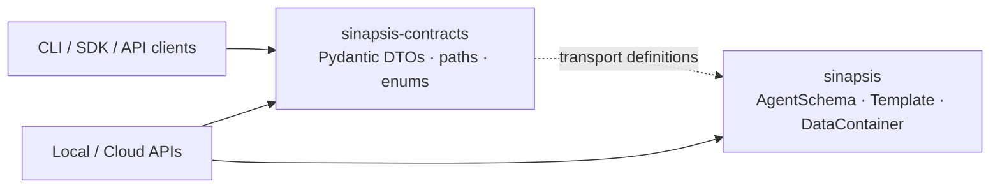

<h1 align="center">
<br>
<a href="https://sinapsis.tech/">
  
</a>
<br>
sinapsis-contracts
<br>
</h1>

<h3 align="center">Shared, typed API contracts for the Sinapsis ecosystem.</h3>

`sinapsis-contracts` defines the **HTTP request and response models**, **endpoint paths**, **enums**, and **shared transport constants** used by Sinapsis APIs, the Python SDK, and CLI integrations.

Contracts keep API consumers and providers aligned. The package is intentionally distinct from the Sinapsis Agent runtime: it describes how services exchange information, not how a workflow is executed.

## Installation

Requires **Python 3.13+** and uses **Pydantic** for typed validation.

```bash
uv pip install sinapsis-contracts
# or
pip install sinapsis-contracts
```

Applications using `sinapsis-sdk` ordinarily receive `sinapsis-contracts` as a dependency automatically.

## Package structure

| Module | Contents |
| --- | --- |
| `sinapsis_contracts.common.paths` | API base version and health endpoint constants. |
| `sinapsis_contracts.common.sentinels` | Shared Sinapsis stream and completion sentinels. |
| `sinapsis_contracts.cloud_api.models` | Cloud Agent execution, status, saved-Agent/version, scheduling, metrics, secret, webhook and package-index models. |
| `sinapsis_contracts.cloud_api.paths` | Cloud endpoint path constants for Agents, Management, scheduling, files, secrets, API keys, webhooks and documentation. |
| `sinapsis_contracts.local_api.models` | Local API requests and responses for Agents, jobs, approval feedback and health. |
| `sinapsis_contracts.local_api.paths` | Local API Agent and job endpoint paths. |
| `sinapsis_contracts.cloud_api.models.api_key_permissions` | Named API-key permission values. |

Import the model or path from its defined package; the top-level `sinapsis_contracts` package is not intended as an all-in-one export.

## Contract boundaries



### One canonical Agent graph

The canonical runtime validator is exposed by `sinapsis`, not by `sinapsis-contracts`:

```python
from sinapsis.agent import AgentSchema, generic_agent_schema_builder

agent_schema: AgentSchema = generic_agent_schema_builder(agent_definition)
```

`agent_definition` is an application-provided Agent dictionary. Contracts representing saved definitions deliberately preserve them as `dict[str, Any]`. They must not reinterpret runtime graph fields or introduce a second Agent-schema validation path.

This distinction matters for derived schema content, numeric `template_type` values, and canonical serialization:

```python
persistable_definition = agent_schema.model_dump(mode="json")
```

The stored definition remains a JSON-compatible representation of the validated runtime schema.

## Local API contracts

The local API defines the following request and response models:

| Model | Purpose |
| --- | --- |
| `AgentResponse`, `AgentsResponse` | Agent creation, listing and process state. |
| `StartJobRequest`, `StartJobResponse` | Start a finite execution for an existing Agent. |
| `JobResponse`, `JobActionResponse` | Query or cancel a job. |
| `ApprovalRequest`, `ApprovalResponse` | Provide approval feedback for an execution. |
| `HealthResponse` | API health and stream identity. |

```python
from sinapsis_contracts.local_api.models import StartJobRequest

request = StartJobRequest(agent_id="my-agent-id")
payload = request.model_dump(mode="json", exclude_none=True)
# {'agent_id': 'my-agent-id'}
```

`StartJobRequest.payload`, when provided, is a **base64-encoded serialized `DataContainer`**, not arbitrary JSON. For transport-compatible encoding and decoding, use the SDK and the Sinapsis protocol APIs.

## Cloud execution contracts

Cloud Agent execution requests and responses live under `cloud_api.models.agents`:

```python
from sinapsis_contracts.cloud_api.models.agents.payloads import InlineAgentExecutionRequest
from sinapsis_contracts.cloud_api.models.agents.responses import AgentCreateResponse

request = InlineAgentExecutionRequest(agent_definition=agent_definition)
response = AgentCreateResponse.model_validate({"job_id": "example-job-id"})
```

`agent_definition` is a Python dictionary of the user-defined graph. Execution status and cancellation use `AgentStatusResponse` and `AgentCancelResponse` respectively.

## Saved Agents and immutable versions

Management contracts for saved Agents are defined in `sinapsis_contracts.cloud_api.models.saved_agent`:

| Type | Role |
| --- | --- |
| `AgentRegisterRequest` | Submit a definition and an explicit version label. |
| `AgentRegistration` | Return registered Agent/version IDs and checksum. |
| `Agent` | Describe saved identity, ownership and metadata. |
| `AgentVersion` | Describe an immutable version and its stored definition. |
| `AgentVersionPublishRequest` | Publish an updated immutable definition. |
| `AgentRegistrationSource` | Distinguish explicit registration from execution-created records. |

```python
from sinapsis_contracts.cloud_api.models.saved_agent import AgentRegisterRequest

request = AgentRegisterRequest(version="v1", definition=agent_definition)
body = request.model_dump(mode="json", exclude_none=True)
```

A version label is required. A saved definition is transferred as an opaque JSON-compatible dictionary; the runtime owns the graph semantics.

## Scheduling contracts

`sinapsis_contracts.cloud_api.models.scheduling` provides creation, update, lifecycle and run-history models.

**Recurrence types** are `ONCE`, `DAILY`, `WEEKLY`, and `INTERVAL`. They have distinct fields:

| Type | Required recurrence fields |
| --- | --- |
| `ONCE` | Timezone-aware `run_at` timestamp. |
| `DAILY` | `local_time`, with an IANA `timezone`. |
| `WEEKLY` | `local_time` plus `weekdays` (`0` Monday through `6` Sunday). |
| `INTERVAL` | `interval_seconds` (60–31,536,000). |

The Pydantic model validates that fields match the selected recurrence type; incompatible combinations raise validation errors.

```python
from datetime import time
from uuid import UUID

from sinapsis_contracts.cloud_api.models.scheduling import (
    ScheduleCreate,
    ScheduleType,
)

schedule = ScheduleCreate(
    name="morning-report",
    agent_id=UUID("00000000-0000-0000-0000-000000000001"),
    agent_version_id=UUID("00000000-0000-0000-0000-000000000002"),
    schedule_type=ScheduleType.DAILY,
    local_time=time(9, 0),
    timezone="Europe/London",
)
```

The UUIDs above are illustrative; the application must supply real IDs from an accessible saved Agent/version. A schedule is pinned to that specific version.

To replace recurrence settings when updating a schedule, the request nests the complete `ScheduleFields` model:

```python
from datetime import time
from sinapsis_contracts.cloud_api.models.scheduling import (
    ScheduleFields, SchedulePatch, ScheduleType,
)

patch = SchedulePatch(
    recurrence=ScheduleFields(
        schedule_type=ScheduleType.DAILY,
        local_time=time(8, 30),
        timezone="Europe/London",
    )
)
```

Other models include `AgentSchedule`, `SchedulePage`, `ScheduleRun`, `ScheduleRunPage`, `ScheduleStatus` and `OccurrenceStatus`. Scheduled occurrences are separate from their execution jobs.

For end-user CLI commands, see [`Scheduling.md`](../../cli/sinapsis-cli/Scheduling.md).

## Endpoint paths

Endpoint paths are centralized so callers do not duplicate literal API routes. Both Local and Cloud use the `/api/v1` API prefix.

```python
from sinapsis_contracts.common.paths import BaseApiPaths
from sinapsis_contracts.local_api.paths import API_JOB_PATHS

job_path = BaseApiPaths.render(
    API_JOB_PATHS.job,
    base=API_JOB_PATHS.base,
    job_id="example-job-id",
)
# /api/v1/jobs/example-job-id
```

Common path instances include `API_AGENT_PATHS`, `API_JOB_PATHS`, `AGENT_PATHS`, `SAVED_AGENT_PATHS`, `SCHEDULE_PATHS`, `FILE_PATHS`, `USER_SECRET_PATHS`, and `WEBHOOK_PATHS`.

The Cloud path classes and Local path classes are distinct. Applications should use the path definitions belonging to their intended API.

## Permissions, results and compatibility

- `ApiKeyPermission` defines named scopes used when requesting a scoped API key. Scopes do not replace server-side access checks.
- Cloud scheduling contracts include `ArchivedResultFrame` / `ArchivedResultPage` for historical MessagePack frames encoded as base64.
- Public models use Pydantic's `model_validate()` and `model_dump(mode="json")`. Some request models use `extra="forbid"`; do not assume every response model has identical unknown-field handling.
- The package also defines webhook, secret, file, metric and package-index request/response models used by their respective integrations.

If a request or response contract changes, update its API provider and consumers together. Reuse existing types and paths rather than maintaining local copies of the same contract.

## Documentation and resources

- [Sinapsis documentation](https://docs.sinapsis.tech/)
- [Tutorials and examples](https://docs.sinapsis.tech/docs/latest/tutorials)
- [Sinapsis website](https://sinapsis.tech/)

## License

Sinapsis open-source components are available under your choice of the  [MIT License](LICENSE-MIT); or the [Apache License 2.0](LICENSE-APACHE) unless otherwise noted.
